Wine Quality Analysis
================

GROUP: John Tapia James Pfaff Jacob Dudas

Imported libraries

# **1) Business Understanding**

Instead of interpreting the dataset alone, it is important to research
the variables in our dataset that represent good-quality wine and which
variables we should consider most significant. The quality of wine,
according to the Wine and Spirit Education Trust (WSET), depends on
several factors, evaluated based on their balance, flavor intensity,
complexity, and how long their flavors last after tasting. From a data
standpoint, it is important to consider red and white wines’ acidity,
sweetness, alcohol content, aroma, and balance. The highest-rated wines
do not necessarily have the highest or lowest levels of any variable,
rather, they have different characteristics that work well together.

Now, let’s discuss the significant variables in the dataset. To begin,
one important factor when considering the best wines is acidity, which
contributes to the wine’s overall taste and “freshness”; too much can
make wine sour, while too little can make it taste flat. Another factor
is volatile acidity, which measures certain acids that can create an
unpleasant vinegar smell at high levels. Residual sugar and alcohol
content also affect wine taste substantially, as sweetness can balance
acidity while alcohol content can overpower other flavors. The
characteristics listed in the dataset suggest that the relationship
between a wine’s chemical makeup and its quality is more complicated
than having higher or lower levels of certain ingredients.

Sources: Green, M. (n.d.). Understanding acidity in wine. Wine & Spirit
Education Trust.
<https://www.wsetglobal.com/news-insights/insight-opinion/understanding-acidity-in-wine/>
Australian Wine Research Institute. (n.d.). Wine flavours, faults and
taints.
<https://www.awri.com.au/industry_support/winemaking_resources/sensory_assessment/recognition-of-wine-faults-and-taints/wine_faults/>

# **2) Data Understanding**

This project analyzes the UCI Wine Quality Dataset, which contains 1,599
red wines and 4,898 white wines from Portugal, for a total of 6,497
observations. Each individual wine observation includes 11 chemical
measurements and a quality score determined by the measurements. All 11
variables are quantitative (ratio and interval), while the quality score
is ordinal. The quality score is on a scale of 0 to 10; in the dataset,
the wines range from 3 to 9, with red wines ranging from 3 to 8 and
white wines from 3 to 9.

| Feature | Description | Data Type |
|:---|:---|:---|
| Fixed Acidity | Amount of acids naturally present in wine that do not easily evaporate | Ratio |
| Volatile Acidity | Amount of acids that can produce a vinegar-like taste or smell | Ratio |
| Citric Acid | Amount of citric acid present, which contributes to acidity and freshness | Ratio |
| Residual Sugar | Amount of sugar remaining after fermentation | Ratio |
| Chlorides | Amount of salt present in the wine | Ratio |
| Free Sulfur Dioxide | Amount of sulfur dioxide available to help preserve wine | Ratio |
| Total Sulfur Dioxide | Total amount of sulfur dioxide, including free and bound forms | Ratio |
| Density | Mass per unit volume of wine | Ratio |
| pH | Measurement of how acidic or basic the wine is | Interval |
| Sulphates | Amount of sulfates present, which can contribute to wine preservation | Ratio |
| Alcohol | Percentage of alcohol in the wine | Ratio |
| Quality | Wine quality rating based on sensory evaluations | Ordinal |
| Color | Wine color (red or white) | Nominal |

Wine Quality Dataset: Feature Descriptions

Based on additional research and discussions with generative AI, pH is
logarithmic rather than a conventional linear scale. It is classified
here as interval because differences in pH are meaningful, but ratios of
pH values are not.

# **3) Data Preparation**

We needed to change the delimiter to “;” when importing data and we
removed extra spaces and tabs around unquoted values. We also hid the
import summary we see to take out unnecessary information.

We then added a new column to each dataset called ‘color’ where its
either red or white. Then we joined the dataset, one on top of the other
since they have the same columns.

The two datasets of red wine and white wine were combined into one
larger dataset, but the color variable was re-added to distinguish color
types. This variable is already established on the wine quality’s
website via a variable type table. Combining these allows us to see
whether our hypotheses hold true, regardless of wine color. Outliers
were not removed from the dataset. Outliers were considered before
combining the sets of red wine and white wine, because both colors may
have varying definitions of what an “outlier” means.

# **4) Modeling+Evaluating**

## **Basic EDA**

Summary statistics using red wine. Tells us about the ranges,
means/medians, and NAs of red wine. As the table below shows, there are
no NAs for red wine. Residual sugar, chlorides, free sulfur dioxide, and
total sulfur dioxide seem to have a more erratic jump to the max from
the 3rd quartile. It does not mean we need to get rid of such data, but
it could help us understand the boxplots or distribution of each
feature, respective of its color.

    ##  fixed acidity   volatile acidity  citric acid    residual sugar     chlorides       free sulfur dioxide total sulfur dioxide    density             pH          sulphates         alcohol         quality     
    ##  Min.   : 4.60   Min.   :0.1200   Min.   :0.000   Min.   : 0.900   Min.   :0.01200   Min.   : 1.00       Min.   :  6.00       Min.   :0.9901   Min.   :2.740   Min.   :0.3300   Min.   : 8.40   Min.   :3.000  
    ##  1st Qu.: 7.10   1st Qu.:0.3900   1st Qu.:0.090   1st Qu.: 1.900   1st Qu.:0.07000   1st Qu.: 7.00       1st Qu.: 22.00       1st Qu.:0.9956   1st Qu.:3.210   1st Qu.:0.5500   1st Qu.: 9.50   1st Qu.:5.000  
    ##  Median : 7.90   Median :0.5200   Median :0.260   Median : 2.200   Median :0.07900   Median :14.00       Median : 38.00       Median :0.9968   Median :3.310   Median :0.6200   Median :10.20   Median :6.000  
    ##  Mean   : 8.32   Mean   :0.5278   Mean   :0.271   Mean   : 2.539   Mean   :0.08747   Mean   :15.87       Mean   : 46.47       Mean   :0.9967   Mean   :3.311   Mean   :0.6581   Mean   :10.42   Mean   :5.636  
    ##  3rd Qu.: 9.20   3rd Qu.:0.6400   3rd Qu.:0.420   3rd Qu.: 2.600   3rd Qu.:0.09000   3rd Qu.:21.00       3rd Qu.: 62.00       3rd Qu.:0.9978   3rd Qu.:3.400   3rd Qu.:0.7300   3rd Qu.:11.10   3rd Qu.:6.000  
    ##  Max.   :15.90   Max.   :1.5800   Max.   :1.000   Max.   :15.500   Max.   :0.61100   Max.   :72.00       Max.   :289.00       Max.   :1.0037   Max.   :4.010   Max.   :2.0000   Max.   :14.90   Max.   :8.000  
    ##        color     
    ##  Length   :1599  
    ##  N.unique :   1  
    ##  N.blank  :   0  
    ##  Min.nchar:   3  
    ##  Max.nchar:   3  
    ## 

    ##        fixed acidity     volatile acidity          citric acid       residual sugar            chlorides  free sulfur dioxide total sulfur dioxide              density                   pH            sulphates 
    ##                    0                    0                    0                    0                    0                    0                    0                    0                    0                    0 
    ##              alcohol              quality                color 
    ##                    0                    0                    0

Summary statistics using white wine. Tells us about the ranges,
means/medians, and NAs of white wine. As the table below shows, there
are no NAs for white wine. The jump from the 3rd quartile to the max
seems to be the same as red wine.

    ##  fixed acidity    volatile acidity  citric acid     residual sugar     chlorides       free sulfur dioxide total sulfur dioxide    density             pH          sulphates         alcohol         quality     
    ##  Min.   : 3.800   Min.   :0.0800   Min.   :0.0000   Min.   : 0.600   Min.   :0.00900   Min.   :  2.00      Min.   :  9.0        Min.   :0.9871   Min.   :2.720   Min.   :0.2200   Min.   : 8.00   Min.   :3.000  
    ##  1st Qu.: 6.300   1st Qu.:0.2100   1st Qu.:0.2700   1st Qu.: 1.700   1st Qu.:0.03600   1st Qu.: 23.00      1st Qu.:108.0        1st Qu.:0.9917   1st Qu.:3.090   1st Qu.:0.4100   1st Qu.: 9.50   1st Qu.:5.000  
    ##  Median : 6.800   Median :0.2600   Median :0.3200   Median : 5.200   Median :0.04300   Median : 34.00      Median :134.0        Median :0.9937   Median :3.180   Median :0.4700   Median :10.40   Median :6.000  
    ##  Mean   : 6.855   Mean   :0.2782   Mean   :0.3342   Mean   : 6.391   Mean   :0.04577   Mean   : 35.31      Mean   :138.4        Mean   :0.9940   Mean   :3.188   Mean   :0.4898   Mean   :10.51   Mean   :5.878  
    ##  3rd Qu.: 7.300   3rd Qu.:0.3200   3rd Qu.:0.3900   3rd Qu.: 9.900   3rd Qu.:0.05000   3rd Qu.: 46.00      3rd Qu.:167.0        3rd Qu.:0.9961   3rd Qu.:3.280   3rd Qu.:0.5500   3rd Qu.:11.40   3rd Qu.:6.000  
    ##  Max.   :14.200   Max.   :1.1000   Max.   :1.6600   Max.   :65.800   Max.   :0.34600   Max.   :289.00      Max.   :440.0        Max.   :1.0390   Max.   :3.820   Max.   :1.0800   Max.   :14.20   Max.   :9.000  
    ##        color     
    ##  Length   :4898  
    ##  N.unique :   1  
    ##  N.blank  :   0  
    ##  Min.nchar:   5  
    ##  Max.nchar:   5  
    ## 

    ##        fixed acidity     volatile acidity          citric acid       residual sugar            chlorides  free sulfur dioxide total sulfur dioxide              density                   pH            sulphates 
    ##                    0                    0                    0                    0                    0                    0                    0                    0                    0                    0 
    ##              alcohol              quality                color 
    ##                    0                    0                    0

Since quality is an ordinal type variable with ±1 discrete steps in
values, finding a regression on a correlation plot would present
difficulties –especially given the small range of quality values (3 to
9). Instead, the independent variables were compared using a series of
box plots assigned to each present quality value. Firstly, a box plot
was constructed to compare quality distribution for all possible
independent variables. This helps identify the variables of interest
that can lead to a hypothetical investigation. This also identifies the
outliers for both red and white wine. These box plots were divided
further by their quality rating (i.e, a quality score of 3 has its own
plot vs. the intended variable. Same with 4, 5, 6, …). The median can be
used to test wine quality’s correlation with a desired independent
variable.

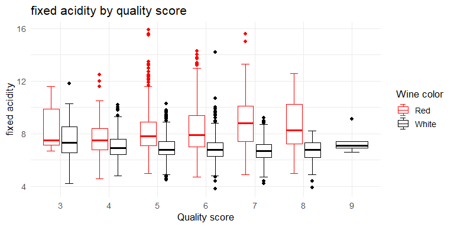<!-- -->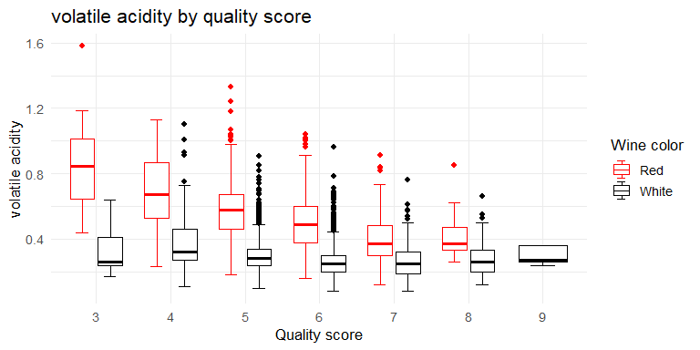<!-- -->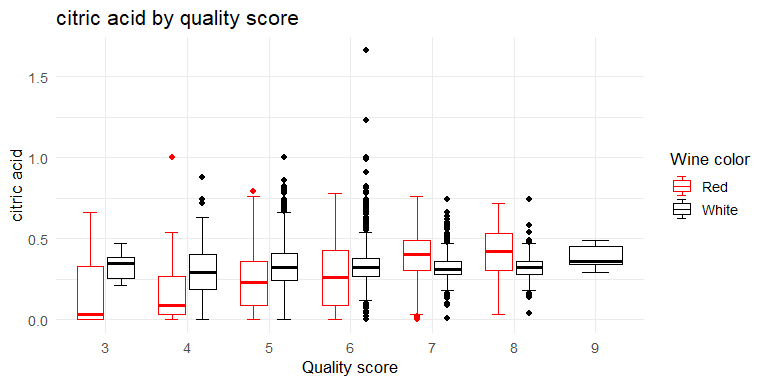<!-- -->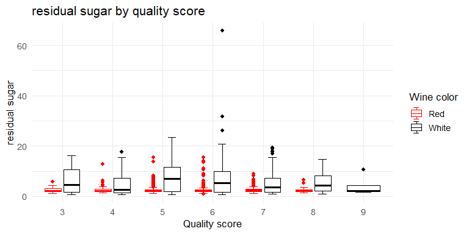<!-- -->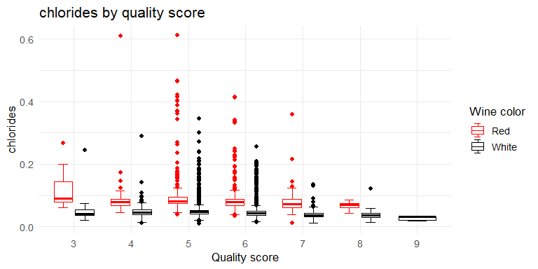<!-- -->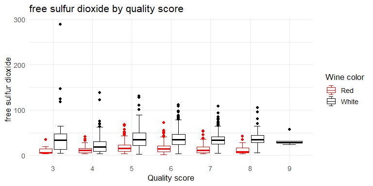<!-- -->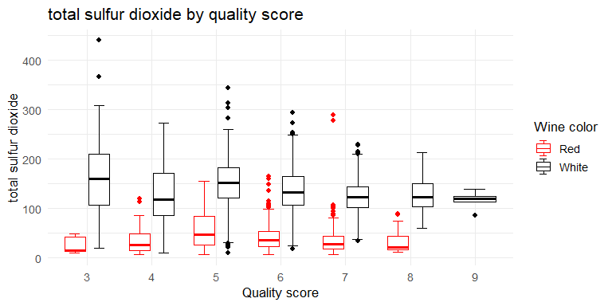<!-- -->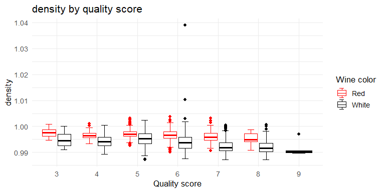<!-- -->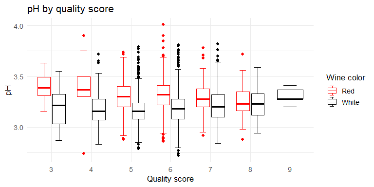<!-- -->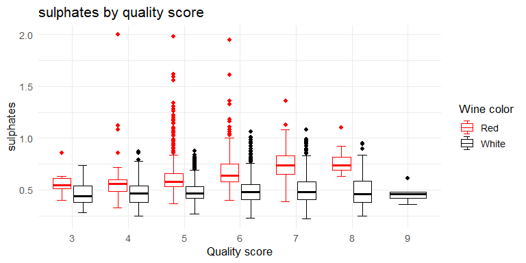<!-- -->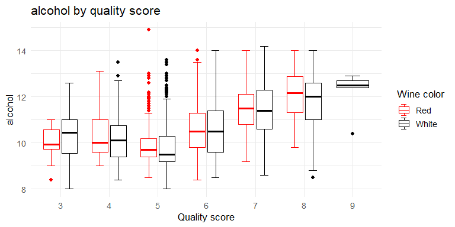<!-- -->

Box plots zoomed in to top whisker to get a better idea of what the
distribtuion of each one looks like. Used Coord-Cartesian to not remove
the data, we just want to zoom in.

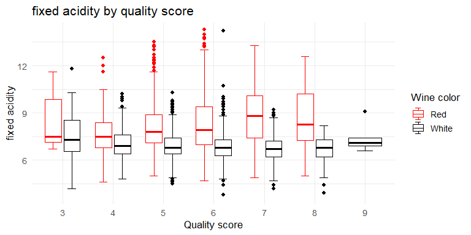<!-- -->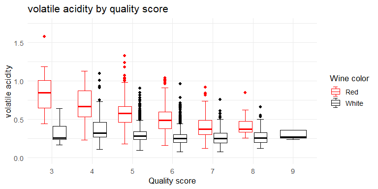<!-- -->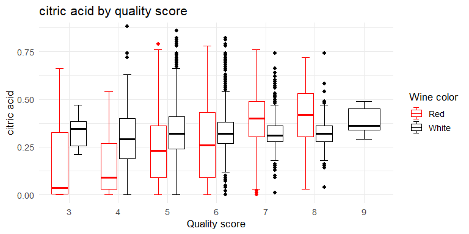<!-- -->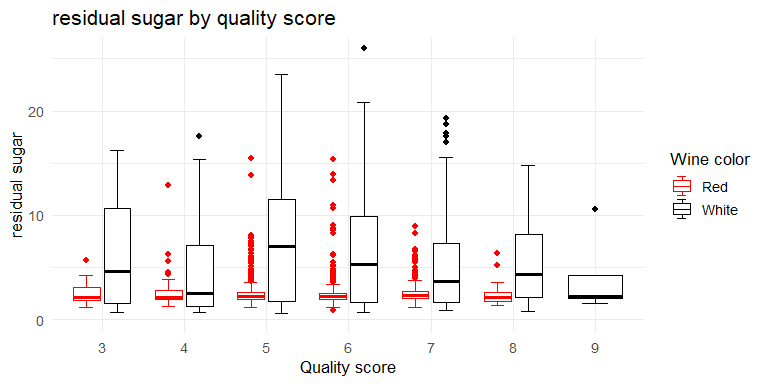<!-- -->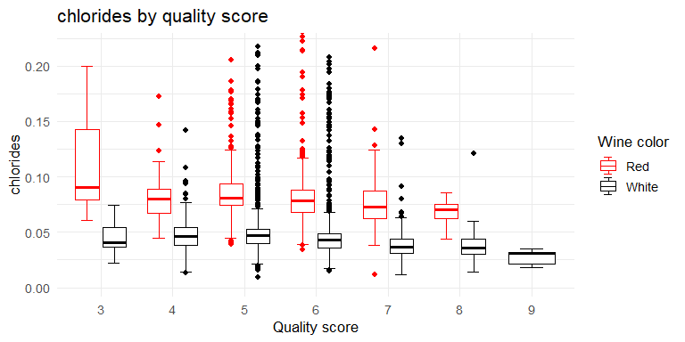<!-- -->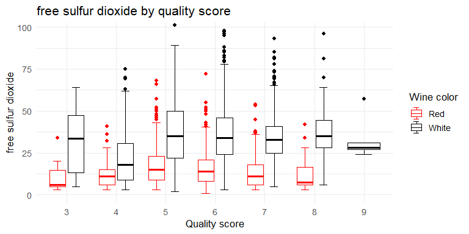<!-- -->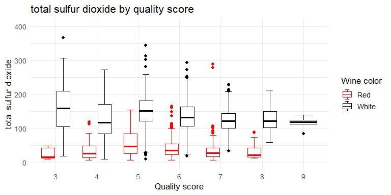<!-- -->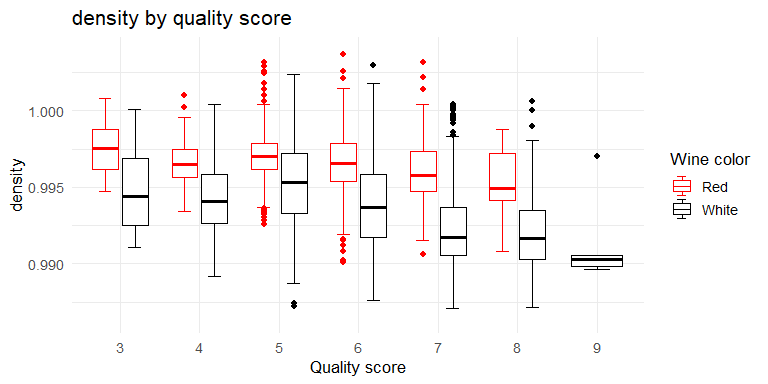<!-- -->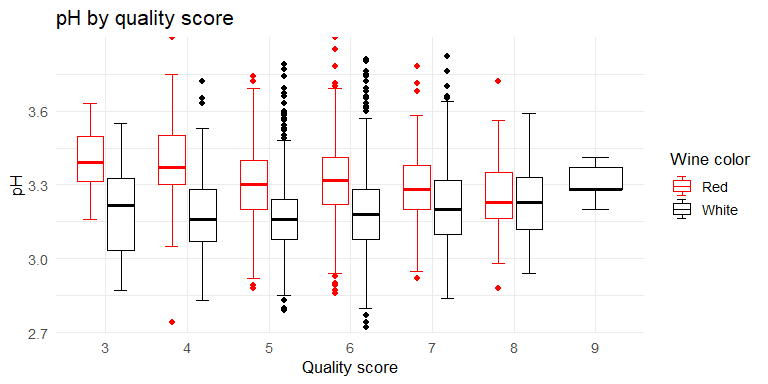<!-- -->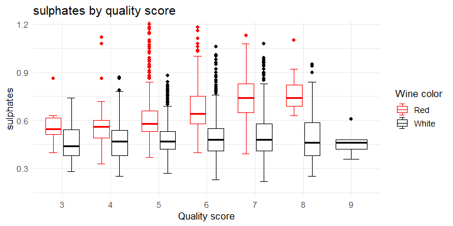<!-- -->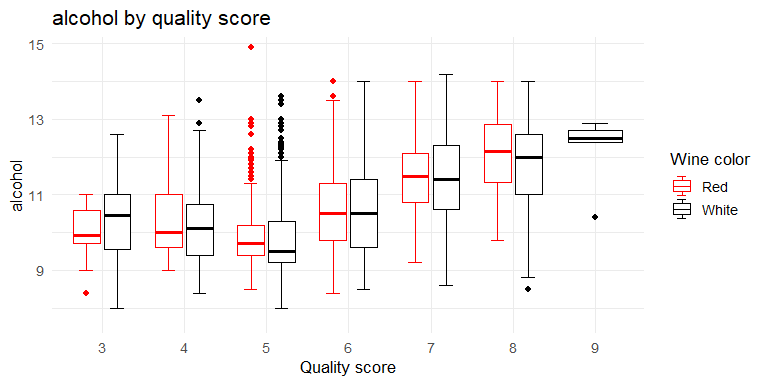<!-- -->

One big takeaway from the box plots is: alcohol is the only independent
variable where the quality score correlated with similar alcohol values.
This would be the only independent variable where it would be fine to
combine red and white wine together, alcohol does not differ much from
each other at each level.

Another takeaway that leads us to our hypothesis test is: Higher
Sulphate levels are correlated with higher quality red wines. Sulphate
levels don’t seem to change too much across the different quality levels
of white wine.

## **Hypothesis test**

Our question becomes: **Is there a positive relationship between
sulphate concentration and wine quality, and is that relationship
stronger for red wines than for white wines?**

Based off our research, a Spearman rank correlation test is a
nonparametric test that works well because our wine quality is ordinal
and Sulphate concentration is numerical. Neither variable has to be
normally or linearly distributed.

Our hypothesis is: H0: rho = 0 and Ha: rho \> 0\

HO is hypothesizing that there is no monotonic association between
sulphate concentration and wine quality in red wines.\

Ha is hypothesizing that higher sulphate concentrations are associated
with higher wine quality in red wines\

    ## 
    ##  Spearman's rank correlation rho
    ## 
    ## data:  red_sulphate and red_quality
    ## S = 424463207, p-value < 2.2e-16
    ## alternative hypothesis: true rho is greater than 0
    ## sample estimates:
    ##       rho 
    ## 0.3770602

The spearman test is a number between -1 and 1, our results gives us
.3771. This tells us that there is a weak to moderate positive trend
between sulfate and quality. Our very small p value tells us to reject
the null hypothesis, there is strong statistical evidence of a positive
correlation between sulphates and red wine quality. However it’s
important to understand that correlation does not mean causation.

Now we do the spearman test for white sulphate and quality.

    ## 
    ##  Spearman's rank correlation rho
    ## 
    ## data:  white_sulphate and white_quality
    ## S = 1.8932e+10, p-value = 0.009853
    ## alternative hypothesis: true rho is greater than 0
    ## sample estimates:
    ##        rho 
    ## 0.03331897

Our result for white wine is 0.0333. This tells us that there is a very
weak positive relationship between sulphates and wine quality, meaning
there is almost no correlation. Our p-value of 0.00985 is below 0.05, so
we reject the null hypothesis. This means there is statistically
significant evidence of a positive correlation between sulphates and
white wine quality, even though the relationship is extremely weak.
However, it’s important to once again understand that correlation does
not mean causation.

Now that we tested spearmans test, we created a loop to go over each
independent variable+quality and compare monotonic relationships.

| color | variable             |     rho | p_value |
|:------|:---------------------|--------:|--------:|
| red   | fixed acidity        |  0.1141 |  0.0000 |
| red   | volatile acidity     | -0.3806 |  1.0000 |
| red   | citric acid          |  0.2135 |  0.0000 |
| red   | residual sugar       |  0.0320 |  0.1001 |
| red   | chlorides            | -0.1899 |  1.0000 |
| red   | free sulfur dioxide  | -0.0569 |  0.9886 |
| red   | total sulfur dioxide | -0.1967 |  1.0000 |
| red   | density              | -0.1771 |  1.0000 |
| red   | pH                   | -0.0437 |  0.9596 |
| red   | sulphates            |  0.3771 |  0.0000 |
| red   | alcohol              |  0.4785 |  0.0000 |
| white | fixed acidity        | -0.0845 |  1.0000 |
| white | volatile acidity     | -0.1966 |  1.0000 |
| white | citric acid          |  0.0183 |  0.0998 |
| white | residual sugar       | -0.0821 |  1.0000 |
| white | chlorides            | -0.3145 |  1.0000 |
| white | free sulfur dioxide  |  0.0237 |  0.0485 |
| white | total sulfur dioxide | -0.1967 |  1.0000 |
| white | density              | -0.3484 |  1.0000 |
| white | pH                   |  0.1094 |  0.0000 |
| white | sulphates            |  0.0333 |  0.0099 |
| white | alcohol              |  0.4404 |  0.0000 |

We can conclude that alcohol has a higher spearman rho for both
colors(red:0.4785,white:0.4404) more than red wines sulphate spearman
rho. We figured out that alcohol has a higher monotonic relationship
with quality for both colors. It’s good to point out that all of them
are statistically significant. Looking back at the alcohol-quality box
plot, the trend is easier to observe when quality is higher than level
5. Whereas, Sulphate’s correlation in red wine quality was immediately
noticeable even in lower qualities.

However, another quality that stood out in red wine is volatile acidity.
Red wine has a negative weak to moderate correlation with volatile
acidity. It’s barely higher than sulphates red correlation in magnitude.
Spearmans rho value for red wine supports the downward trend in the
boxplot. But it’s important to note that the p value is 1, which is more
than our significance level of 0.05. So it’s not statistically
significant.

## **Conclusion**

The wine producer should look at alcohol levels for the quality of both
wines. They should also look at sulphate as a secondary indicator for
red wine. There are not enough visible trends to make a confident
assumption with the rho values of a secondary indicator to look at for
white wine.
